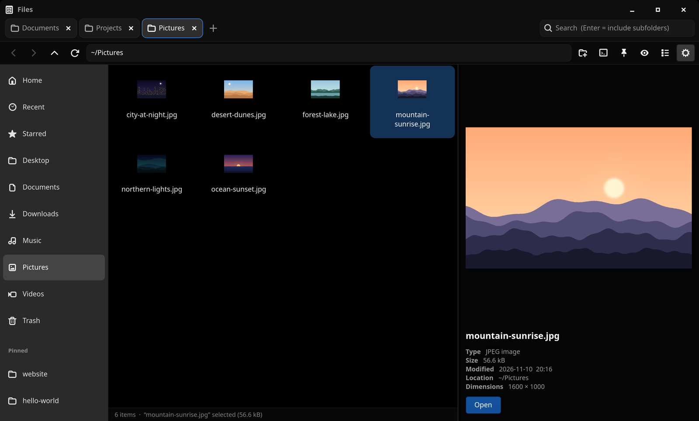
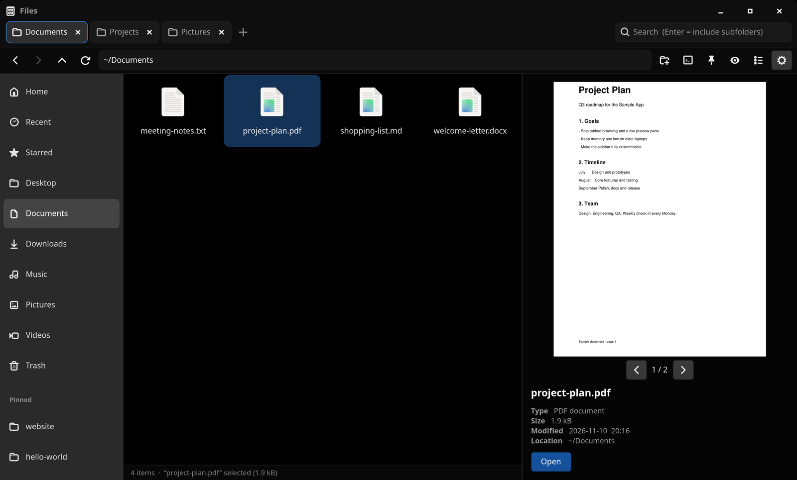
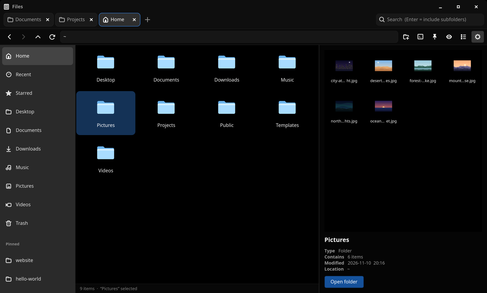

# RFiles

[](https://github.com/S0CloseYetS0Far/R-files/actions/workflows/ci.yml)

A fast, lightweight file manager for Ubuntu, written in Rust with GTK4.
Pitch-black file area, browser-style tabs, and a big live preview pane:
click once on any file or folder to see it on the right.



## Screenshots

| PDF preview | Folder preview |
|---|---|
|  |  |

Click once on a PDF to read it page by page, or on a folder to see what's inside without opening it.

## Features

- **Tabs**: a small **+** right after your tabs opens a new one (or Ctrl+T)
- **Live preview**: folders, images, video, audio, PDF, Word / LibreOffice / PowerPoint / Excel (text), zip archives, and any text or code file
- **Sidebar** with Home, Recent, Starred, Documents, Downloads, Trash and more. Drag items to reorder them
- **Pin folders** to the sidebar with one click (click again to unpin)
- **Copy / cut / paste** (works together with GNOME Files); copies, moves, deletes, compress and extract keep running after their window is closed, and Ctrl+Q asks before stopping them
- **Drag and drop** files between folders, the sidebar and other apps (same drive moves, other drive copies; Ctrl copies, Shift moves)
- **Thumbnails** for images and PDFs, and for videos, fonts and other files that an installed `.thumbnailer` handles (run the same sandboxed way), made in the background for the files on screen and shared with GNOME Files. Files are decoded in a separate, time- and memory-limited process, inside a bubblewrap sandbox (no network, only that one file visible) where bwrap works
- **Compress / extract**: .zip, .tar.gz, .tar.xz, .tar.bz2 and .tar.zst (Compress…, Extract Here and Extract to… in the right-click menu)
- **Properties**: size (live folder totals, plus size on disk), free space, default app, dates, owner and editable permissions (also applied to enclosed files)
- **Batch rename** several files at once: find & replace, or numbering like `Holiday ###`, with a live preview
- **Open in Terminal** from any folder
- **Custom icons**: light-blue folders by default, the system theme, your own image, or a different icon per file
- **Search** at the top right: filters as you type, Enter searches subfolders too. The ⋯ button next to it has an opt-in "Also search inside text files" (text files under 2 MB and office documents; not PDFs)
- **Sort** by name, size, modified date or type, folders always first: right-click empty space, or click a column header in the list view (click again to reverse)
- **Hide the sidebar or the preview pane** for more room (F9 / F4); nothing is previewed while the preview is hidden
- Remembers your window size, sidebar and preview widths
- Light on memory (about 45 MB) and quick to open (about 0.2 s). On laptops with two graphics cards it leaves the sleeping one asleep

## RFiles vs. GNOME Files (Nautilus)

Measured on Ubuntu 26.04 with Nautilus 50.2, both apps opening the same folder
of 28 wallpaper images (average of 3 runs, memory taken 6 s after launch,
on a laptop with Intel + NVIDIA graphics; numbers vary with the graphics driver):

| | **RFiles** | **GNOME Files** |
|---|---|---|
| Memory actually used (PSS) | **~44 MB** | ~85 MB |
| Memory shown by system monitor (RSS) | **~85 MB** | ~204 MB |
| Program size | 1.7 MB, one file | 1.7 MB + extra packages |
| Background helpers | none | file indexer for search (~24 MB) |

| Feature | **RFiles** | **GNOME Files** |
|---|---|---|
| Preview pane on the right | ✅ one click: images, video, audio, PDF, office docs, code, zip, folders | ❌ (Space-bar preview needs the separate Sushi package) |
| Tabs | ✅ | ✅ |
| Pin folders to the sidebar | ✅ one-click toggle | ✅ bookmarks |
| Reorder built-in places (Home, Trash, …) | ✅ | ❌ bookmarks only |
| Theme: Black, Light or follow the system (with its accent colour) | ✅ gear menu, Black by default | ✅ follows the system |
| Custom folder icons and size | ✅ light blue, system, or your own image | icon size only |
| Open in Terminal | ✅ built in | needs an extension |
| Search | file names, Enter includes subfolders | ✅ faster, also searches inside documents |
| Copy / cut / paste | ✅ with progress; asks on a taken name: keep both, replace or skip | ✅ with progress, overwrite prompts |
| Undo (Ctrl+Z) | ✅ rename, move, copy, new folder, move to trash (not permanent delete or replace) | ✅ |
| Drag and drop files | ✅ | ✅ |
| Creates thumbnails | ✅ images, PDFs and videos (system thumbnailers) | ✅ also videos |
| Compress / extract | ✅ zip, tar.gz, tar.xz, tar.bz2, tar.zst | ✅ more formats |
| Properties dialog | ✅ | ✅ |
| Batch rename | ✅ find & replace, numbering | ✅ |

**In short:** RFiles now covers the everyday file-management basics and adds the
instant preview pane, with less memory. GNOME Files still has faster
full-text search and more archive formats. The two work side by side: copy/paste,
drag and drop and thumbnails are shared between them.

## Install (Ubuntu 24.04 or newer)

### Option 1: build from source with the script

Open a terminal and run:

```bash
git clone https://github.com/S0CloseYetS0Far/R-files.git
cd R-files
./install.sh
```

The script installs the few packages needed to build, installs Rust if you
don't have it, builds RFiles and adds it to your app grid. It asks for your
password once (for `apt`). It puts the program in `~/.local/bin`, which must be on your `PATH` for the
`rfiles` command to work (on Ubuntu the folder is added to `PATH` at login, so log out and in once if
`rfiles` is not found right after the first install). The app grid entry works either way.

Then open **RFiles** from the app grid, or run `rfiles` (or `rfiles ~/Some/Folder`).

With the script, to update run `git pull` and `./install.sh` again; if RFiles is open, its windows keep running the
old version until you close them all (or press Ctrl+Q).

To uninstall the script install: `./install.sh uninstall`

### Option 2: the .deb package (no compiling)

If the [Releases](https://github.com/S0CloseYetS0Far/R-files/releases) page has a `.deb` for your version,
download it and run:

```bash
sudo apt install ./rfiles_*.deb
```

Then open **RFiles** from the app grid, or run `rfiles`. To update, install the newer `.deb` the same way;
to remove it: `sudo apt remove rfiles`.

### Make RFiles your default file manager

```bash
./install.sh set-default
```

(Run it from a clone of this repository; it works for both the `.deb` and the script install.
The `.deb` does not do this by itself.)

This makes folders open in RFiles (desktop icons, "Open folder" in download
notifications, other apps) and makes **"Show in folder"** from Firefox, Brave,
Chrome, VS Code and the desktop portal open RFiles with the file selected.
For that, RFiles answers the standard `org.freedesktop.FileManager1` D-Bus
service. All RFiles windows share one process, so when RFiles is already open
a "Show in folder" window appears in about 30 ms; otherwise it starts on demand
and exits 30 seconds after its last window closes.

GNOME Files (Nautilus) wants the same role, and Ubuntu's desktop icons start it
at login. So `set-default` also starts a small helper at login,
`rfiles --keep-file-manager` (no window, no GTK). It holds the role and passes
each request to RFiles. If GNOME Files got there first, the helper takes over
as soon as GNOME Files closes, and GNOME Files can't take it back.

Optional extras:

- **Dock:** right-click RFiles in the app grid → *Pin to Dash*, and unpin Files.
- **Super+E shortcut:** Settings → Keyboard → Custom Shortcuts → add command `rfiles`.

Keep GNOME Files installed; Ubuntu uses it in a few places. To switch back:
`./install.sh unset-default`.

### Automatic updates

```bash
./install.sh auto-update on
```

Two minutes after you log in, and then every hour, RFiles checks GitHub. When
`main` has something new, it builds and installs it, and shows a notification.
It builds in its own copy of the code (`~/.local/share/rfiles/src`), not in your
clone. Open RFiles windows switch to the new version once you close them. Run
`./install.sh update` to check right now, `journalctl --user -u rfiles-update`
to see what it did, and `./install.sh auto-update off` to stop it.
It needs the script install (`./install.sh`), not the `.deb`.

## Shortcuts

| Action | How |
|---|---|
| New tab / close tab | **+** or Ctrl+T / × or Ctrl+W (middle-click works too; Ctrl+W on the last tab closes the window) |
| Reopen a closed tab | Ctrl+Shift+T (the last 10, with their back / forward history) |
| Reorder tabs / drop files on a tab | Drag a tab along the strip / drag files onto a tab to copy or move them there (rest on it for a moment to switch to it) |
| New window / quit | Ctrl+N / Ctrl+Q (quit closes every window) |
| Switch tabs | Ctrl+PageDown / Ctrl+PageUp |
| Tab keys (tab focused) | Left / Right / Home / End move between tabs, Enter or Space opens, Delete closes |
| Preview / open | single-click / double-click or Enter (several selected: opens all, up to 20; the first folder here, other folders in new tabs) |
| Copy / cut / paste | Ctrl+C / Ctrl+X / Ctrl+V |
| Undo / redo a file operation | Ctrl+Z / Ctrl+Shift+Z (rename, move, copy, new folder, move to trash; also at the top of the right-click menu on empty space) |
| Select several | Ctrl+click, Shift+click, drag a box, Ctrl+A |
| Rename / move to trash | F2 (several selected = batch rename) / Delete |
| Delete permanently | Shift+Delete (asks first) |
| Properties | Alt+Enter or Ctrl+I |
| Drag to copy / move | drag files; hold Ctrl to copy, Shift to move |
| New folder | Ctrl+Shift+N |
| Pin / unpin this folder | pin button or Ctrl+D |
| Open in terminal | Ctrl+Alt+T |
| Search / path bar | Ctrl+F / Ctrl+L (`~` works; Tab completes folder names, Esc cancels) |
| Back / forward / up | Alt+Left / Alt+Right / Alt+Up |
| Hidden files | Ctrl+H |
| Grid / list view | Ctrl+1 / Ctrl+2 |
| Right-click menu from the keyboard | Menu key or Shift+F10 (on files or a sidebar item); arrows to move, Enter to choose |
| Show / hide sidebar / preview pane | F9 / F4 (or their buttons in the path bar) |
| Keyboard shortcuts list | Ctrl+? or F1 (also in the gear menu, with About) |

Right-click anything for more (star, change icon, open with, etc.).
Right-click a sidebar item to move it up or down or open it in a new tab.
The gear button at the right of the path bar sets the folder icon style, icon size and theme (Black, Light, or follow the system).
`rfiles --version` prints the version; the desktop entry also has a *New Window* action.

Settings, pins and stars are stored in `~/.config/rfiles/`.

## Build manually

Needs Rust 1.92 or newer (Ubuntu's `cargo` package is older; use [rustup](https://rustup.rs)).

```bash
sudo apt install libgtk-4-dev libpoppler-glib-dev build-essential pkg-config
cargo build --release
./target/release/rfiles
```

## Making a release

Push a tag named `vX.Y.Z` (for example `git tag v0.2.0 && git push origin v0.2.0`). The
`Release` workflow then builds the `.deb` on Ubuntu 24.04 and attaches it to a GitHub Release.
Set `version` in `Cargo.toml` to match first.
