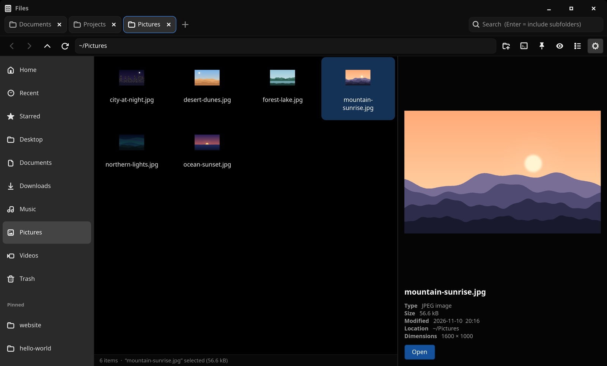
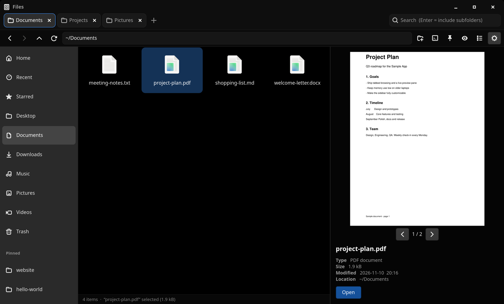
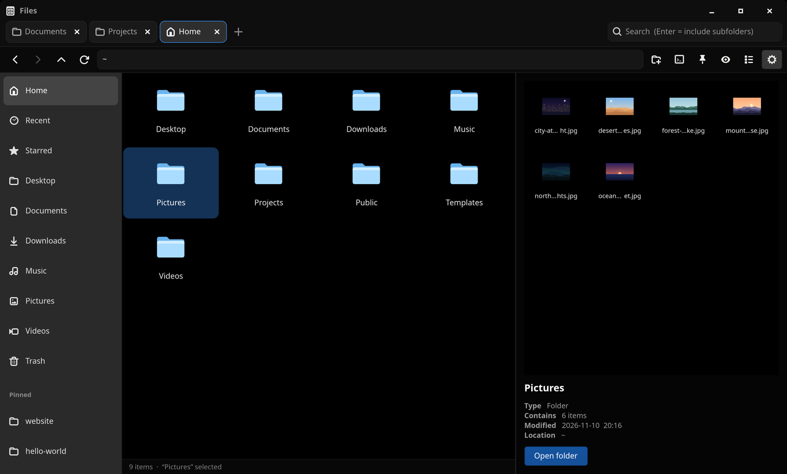

# RFiles

A fast, lightweight file manager for Ubuntu, written in Rust with GTK4.
Pitch-black file area, browser-style tabs, and a big live preview pane:
click once on any file or folder to see it on the right.



## Screenshots

| PDF preview | Folder preview |
|---|---|
|  |  |

Click once on a PDF to read it page by page, or on a folder to see what's inside without opening it.

## Features

- **Tabs**: a small **+** right after your tabs opens a new one (or Ctrl+T)
- **Live preview**: folders, images, video, audio, PDF, Word / LibreOffice / PowerPoint / Excel (text), zip archives, and any text or code file
- **Sidebar** with Home, Recent, Starred, Documents, Downloads, Trash and more. Drag items to reorder them
- **Pin folders** to the sidebar with one click (click again to unpin)
- **Copy / cut / paste** (works together with GNOME Files)
- **Open in Terminal** from any folder
- **Custom icons**: light-blue folders by default, the system theme, your own image, or a different icon per file
- **Search** at the top right: filters as you type, Enter searches subfolders too
- Remembers your window size, sidebar and preview widths
- Light on memory (about 70 MB)

## RFiles vs. GNOME Files (Nautilus)

Measured on Ubuntu 26.04 with Nautilus 50.2, both apps opening the same folder
of 28 wallpaper images (average of 3 runs, memory taken 6 s after launch):

| | **RFiles** | **GNOME Files** |
|---|---|---|
| Memory actually used (PSS) | **~68 MB** | ~85 MB |
| Memory shown by system monitor (RSS) | ~178 MB | ~204 MB |
| Program size | 0.9 MB, one file | 1.7 MB + extra packages |
| Background helpers | none | file indexer for search (~24 MB) |

| Feature | **RFiles** | **GNOME Files** |
|---|---|---|
| Preview pane on the right | ✅ one click: images, video, audio, PDF, office docs, code, zip, folders | ❌ (Space-bar preview needs the separate Sushi package) |
| Tabs | ✅ | ✅ |
| Pin folders to the sidebar | ✅ one-click toggle | ✅ bookmarks |
| Reorder built-in places (Home, Trash, …) | ✅ | ❌ bookmarks only |
| Custom folder icons and size | ✅ light blue, system, or your own image | icon size only |
| Open in Terminal | ✅ built in | needs an extension |
| Search | file names, Enter includes subfolders | ✅ faster, also searches inside documents |
| Copy / cut / paste | ✅ basic | ✅ with progress, undo and overwrite prompts |
| Drag and drop files | ❌ | ✅ |
| Creates thumbnails | ❌ uses existing ones | ✅ |
| Compress / extract, properties, batch rename | ❌ | ✅ |

**In short:** RFiles is built for browsing and looking at files quickly. GNOME
Files is the more complete tool for managing them. The two work side by side,
and copy/paste works between them.

## Install (Ubuntu 24.04 or newer)

Open a terminal and run:

```bash
git clone https://github.com/S0CloseYetS0Far/R-files.git
cd R-files
./install.sh
```

The script installs the few packages needed to build, installs Rust if you
don't have it, builds RFiles and adds it to your app grid. It asks for your
password once (for `apt`).

Then open **RFiles** from the app grid, or run `rfiles` (or `rfiles ~/Some/Folder`).

To uninstall: `./install.sh uninstall`

## Shortcuts

| Action | How |
|---|---|
| New tab / close tab | **+** or Ctrl+T / × or Ctrl+W (middle-click works too) |
| Switch tabs | Ctrl+PageDown / Ctrl+PageUp |
| Preview / open | single-click / double-click or Enter |
| Copy / cut / paste | Ctrl+C / Ctrl+X / Ctrl+V |
| Select several | Ctrl+click, Shift+click, drag a box, Ctrl+A |
| Rename / move to trash | F2 / Delete |
| New folder | Ctrl+Shift+N |
| Pin / unpin this folder | pin button or Ctrl+D |
| Open in terminal | Ctrl+Alt+T |
| Search / path bar | Ctrl+F / Ctrl+L (`~` works) |
| Back / forward / up | Alt+Left / Alt+Right / Alt+Up |
| Hidden files | Ctrl+H |
| Grid / list view | Ctrl+1 / Ctrl+2 |

Right-click anything for more (star, change icon, open with, etc.).
Right-click a sidebar item to move it up or down or open it in a new tab.
The gear button at the right of the path bar sets the folder icon style and icon size.

Settings, pins and stars are stored in `~/.config/rfiles/`.

## Build manually

```bash
sudo apt install libgtk-4-dev libpoppler-glib-dev build-essential pkg-config
cargo build --release
./target/release/rfiles
```
